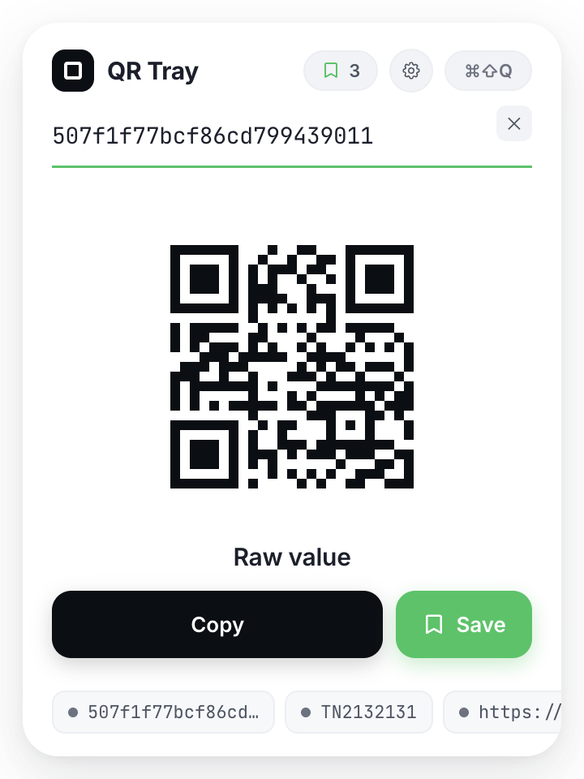

# QR Tray

> Generate QR codes instantly from your Mac's menu bar — no browser needed.

<p align="center">
  
</p>

A tiny macOS menu bar app that turns any text or ID into a QR code on the spot.
Built to stop relying on sites like qr.io when you repeatedly need a quick QR to
**test or validate data** — an ObjectId, an identifier, a token, a URL, or any
string. One global shortcut and it's on screen. Everything runs locally and
offline; nothing you type leaves your machine.

## Features

- ⌨️ **Global shortcut** — `⌘⇧Q` toggles the panel from any app.
- ⚡ **Live QR** — renders as you type or paste, no "generate" button.
- 🕘 **Recents & saved** — history and named favorites, persisted between launches.
- 📋 **Copy** — original text to clipboard in one click.
- 🎨 **Theme & language** — light/dark/system, English/Spanish.
- 📌 **Flexible window** — keep it fixed or auto-hide on blur; locked under the
  icon or freely movable, and it remembers where you left it.
- 🔒 **100% local** — no network, no telemetry.

## Usage

Open with `⌘⇧Q` (or click the menu bar icon), type or paste, and the QR appears
instantly — copy it, save it, or scan straight off the screen.

## Install (macOS)

QR Tray isn't code-signed or notarized, so macOS Gatekeeper will warn on first
launch. To run it:

1. Build the app: `npm run dist` (produces a `.dmg` in `release/`).
2. Open the `.dmg` and drag **QR Tray** into Applications.
3. On first launch, right-click the app → **Open** → **Open**, or go to
   **System Settings → Privacy & Security → Open Anyway**.

If it still won't open, clear the quarantine flag:

```bash
xattr -dr com.apple.quarantine "/Applications/QR Tray.app"
```

## Development

```bash
npm install      # dependencies
npm run build    # compile TypeScript to dist/
npm start        # build + launch with Electron
npm run dist     # build a universal .dmg (Intel + Apple Silicon) in release/
```

## Stack

Electron + TypeScript · [qrcode-generator](https://github.com/kazuhikoarase/qrcode-generator) (vendored, offline) · local `localStorage` persistence.

## License

MIT
